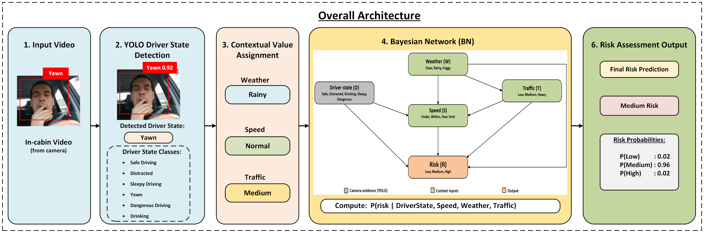
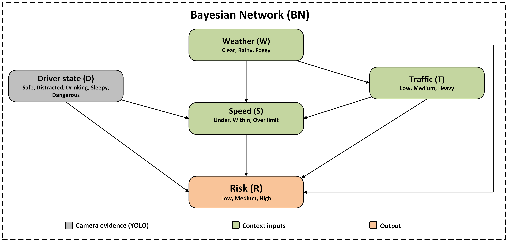
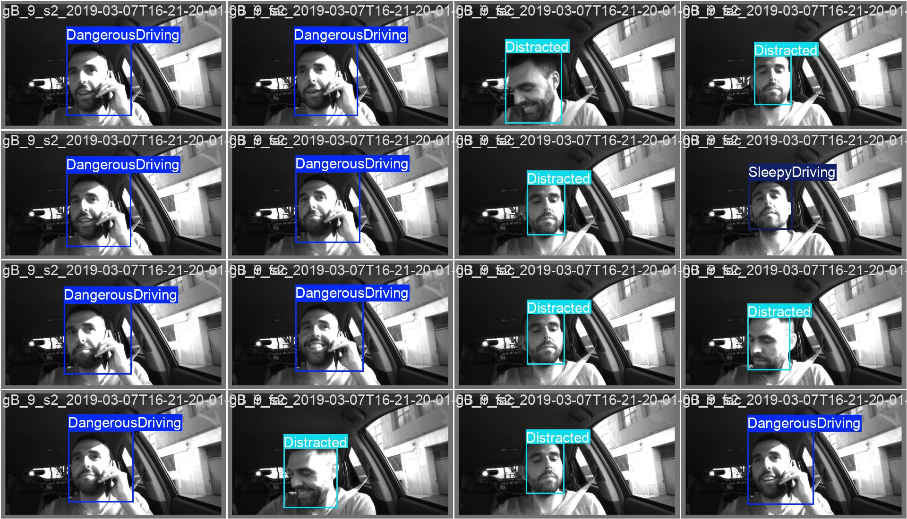
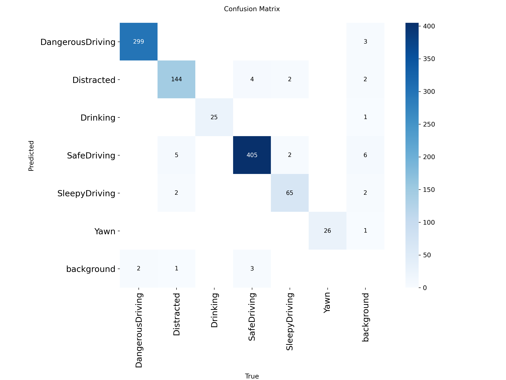
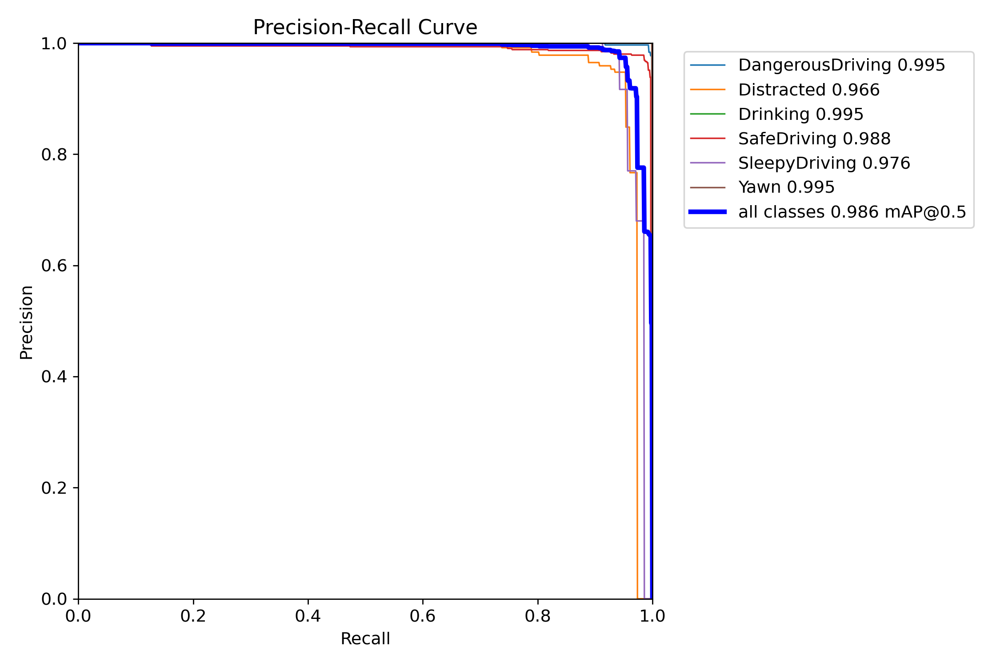
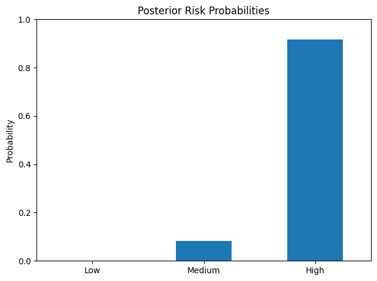
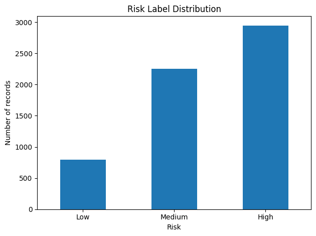
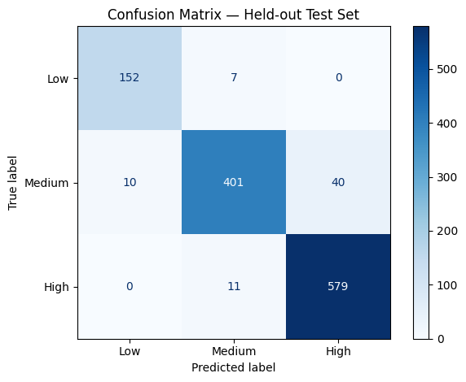

# Probabilistic Driver Risk Prediction

A driver-risk assessment project that combines YOLO-based driver-state detection with a Bayesian Network to estimate risk from driver behaviour and driving context.

The current repository contains the trained YOLO model and evaluation outputs, sample driving videos, a dataset, and a Jupyter notebook for the probabilistic risk assessment.

## Overview

The project is organized into two main parts:

1. **Driver-state detection:** A YOLO model detects driver-state categories in in-cabin images or video frames.
2. **Probabilistic risk assessment:** A Bayesian Network combines a driver-state label with contextual variables such as weather, traffic, and speed to estimate a risk category.

The intended risk output is **Low**, **Medium**, or **High**.

## System workflow

```text
In-cabin video
      |
      v
YOLO driver-state detection
      |
      v
Driver state + driving context
(Weather, Traffic, Speed)
      |
      v
Bayesian Network
      |
      v
Risk probabilities
(Low / Medium / High)
```

## Architecture



The Bayesian Network represents the dependencies assumed in this project. Its conditional probability tables (CPTs) are learned from the prepared data, and inference is used to compute the posterior probability of each risk category given the observed evidence.



## Driver-state detection

The YOLO model is configured for six classes:

- DangerousDriving
- Distracted
- Drinking
- SafeDriving
- SleepyDriving
- Yawn

Example predictions from the model are shown below.



### YOLO evaluation

The repository includes YOLO evaluation outputs such as a confusion matrix and a precision-recall curve.





The precision-recall plot reports an overall **mAP@0.5 of 0.986** for the shown validation run. Treat this as the metric from that specific run, not a guarantee of performance on all videos or driving conditions.

## Bayesian Network risk assessment

The notebook models the relationship between these variables:

| Variable | Role | Example values |
|---|---|---|
| `DriverState` | Detected driver behaviour/state | `SafeDriving`, `Distracted`, `Drinking`, `SleepyDriving`, `Yawn`, `DangerousDriving` |
| `Weather` | Context input | `Clear`, `Rainy`, `Foggy` |
| `Traffic` | Context input | `Low`, `Medium`, `Heavy` |
| `Speed` | Context input | `Normal`, `High` |
| `Risk` | Predicted target | `Low`, `Medium`, `High` |

The network estimates:

$$
P(\text{Risk} \mid \text{DriverState}, \text{Weather}, \text{Traffic}, \text{Speed})
$$

A risk prediction is produced by comparing the posterior probabilities of the three risk classes.



### Risk dataset and evaluation

The risk label distribution in the supplied dataset is imbalanced, with more High-risk and Medium-risk examples than Low-risk examples.



The notebook evaluates the network on a held-out test split and reports metrics including accuracy, precision, recall, F1-score, log loss, and a confusion matrix. The stored risk confusion matrix below is an example result from the notebook.



The figure shows the class counts for the illustrated held-out test run. Re-run the notebook to reproduce the metrics for the dataset currently checked out.

## Repository structure

```text
probabilistic-driver-risk-prediction/
├── Final_dataset/
│   └── driver_risk_final_data1.csv
├── Model_Output/
│   └── yolo26s_driver_risk_best.pt
├── Source_Code/
│   └── Driver_Risk_Assessment_Final.ipynb
├── Videos/
│   ├── video1.mp4
│   ├── video2.mp4
│   ├── video3.mp4
│   └── video4.mp4
├── YOLO_Predictions/
│   └── runs/
│       ├── confusion_matrix.png
│       ├── confusion_matrix_normalized.png
│       ├── BoxPR_curve.png
│       ├── BoxP_curve.png
│       ├── BoxR_curve.png
│       └── validation prediction images
├── Images/
│   ├── overall_Architecture.png
│   ├── BN_final.jpeg
│   ├── yolo_prediction.jpg
│   ├── yolo_confusion_matrix.png
│   ├── yolo_pr.png
│   ├── risklabel.png
│   ├── confusion.png
│   └── particular_risk_scenanrio.png
└── README.md
```

The `Images/` folder referenced above contains the project figures used in this README. If you have not uploaded those figures to GitHub yet, add them to a folder named `Images` at the repository root or adjust the paths in this README.

## Run the Bayesian Network notebook

### 1. Clone the repository

```bash
git clone https://github.com/NamburiRupesh/probabilistic-driver-risk-prediction.git
cd probabilistic-driver-risk-prediction
```

### 2. Create and activate a virtual environment (recommended)

Windows:

```bash
python -m venv .venv
.venv\Scripts\activate
```

macOS/Linux:

```bash
python -m venv .venv
source .venv/bin/activate
```

### 3. Install dependencies

```bash
python -m pip install --upgrade pip
python -m pip install numpy pandas matplotlib scikit-learn pgmpy networkx jupyter
```

### 4. Open the notebook

```bash
jupyter notebook Source_Code/Driver_Risk_Assessment_Final.ipynb
```

Before running it, check the dataset path in the notebook's loading cell. If you are using the repository copy, set the path to:

```python
from pathlib import Path

file_path = Path("Final_dataset/driver_risk_final_data1.csv")
```

Run the notebook cells from top to bottom.

## Important notes and limitations

- The Bayesian Network's results depend on the dataset, the train/test split, the network structure, and the learned CPTs.
- The risk dataset is a prepared demonstration dataset. Unless its labels have been verified against real driving outcomes, the reported risk-classification metrics should be described as results on this dataset—not real-world accident-prediction accuracy.
- Rows with repeated feature combinations can occur in both training and test splits. This evaluates held-out rows from the same data distribution; it does not necessarily measure generalization to unseen drivers or trips.
- The YOLO mAP value and the Bayesian Network classification accuracy refer to different tasks and should not be compared as if they were the same metric.
- A static Bayesian Network represents the dependencies specified by its graph. A Dynamic Bayesian Network would require explicitly modelling temporal state transitions; it is not implied by the current static network alone.
- This project is a research and educational prototype, not a certified driver-monitoring or vehicle-safety system.

## Future work

- Connect YOLO predictions and contextual data directly to a single inference pipeline.
- Validate the Bayesian Network on independently collected and labelled driving data.
- Evaluate generalization with splits by driver or trip where those identifiers are available.
- Calibrate predicted probabilities and assess performance across risk classes.
- Add temporal modelling if implementing a Dynamic Bayesian Network.

## Acknowledgements

This project uses YOLO-based object detection and `pgmpy` for probabilistic graphical modelling. Please cite or acknowledge the relevant libraries and any third-party datasets according to their licenses and terms.
